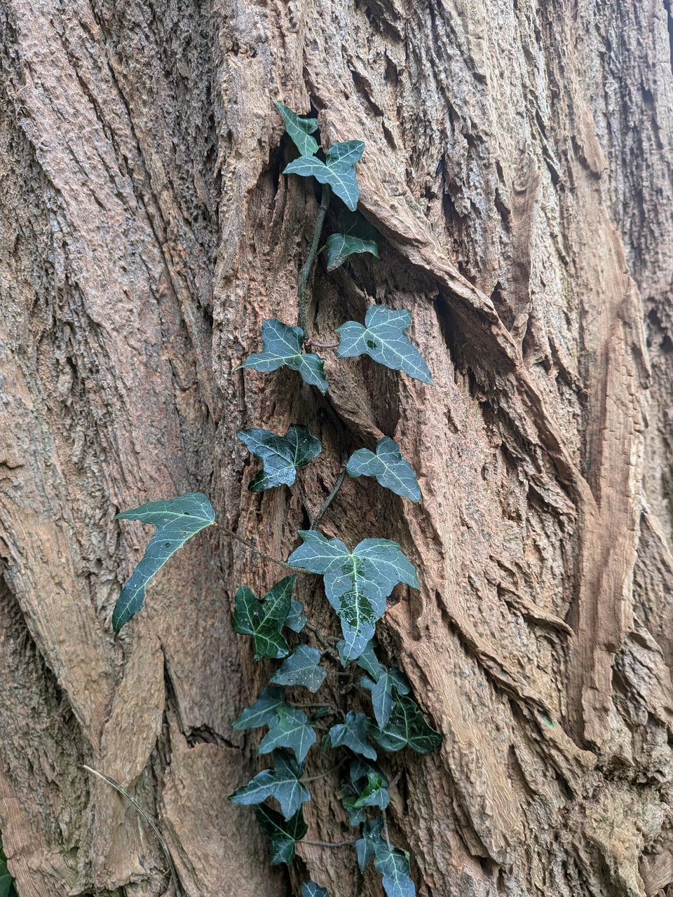
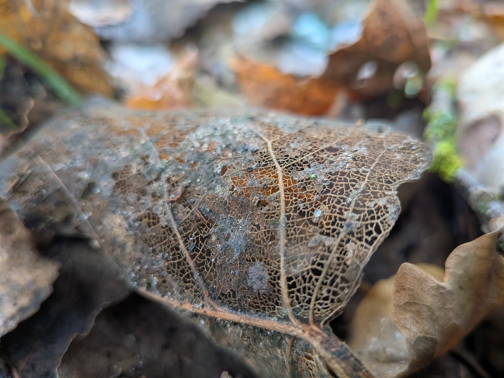
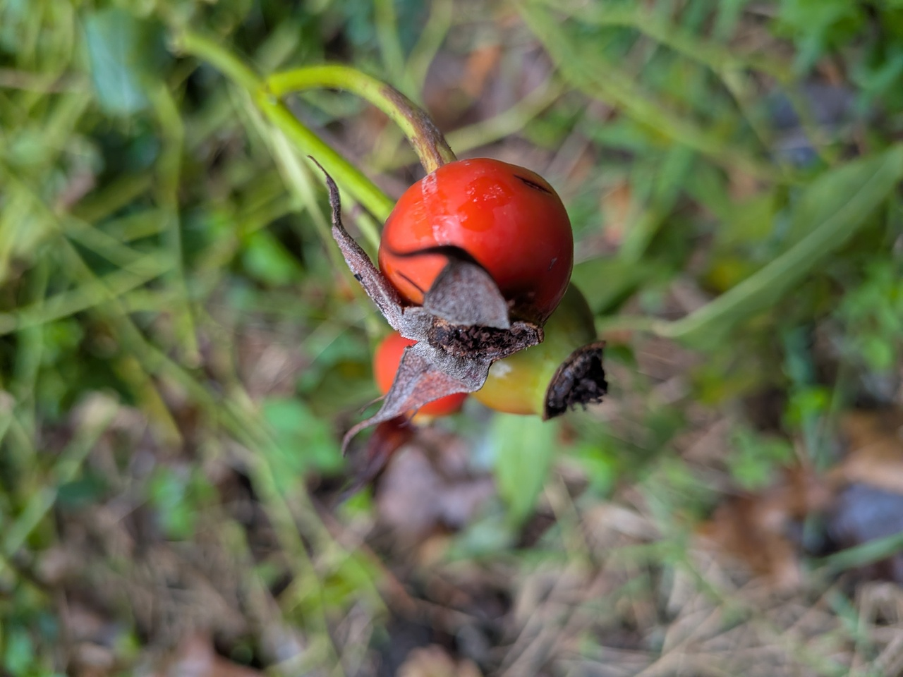
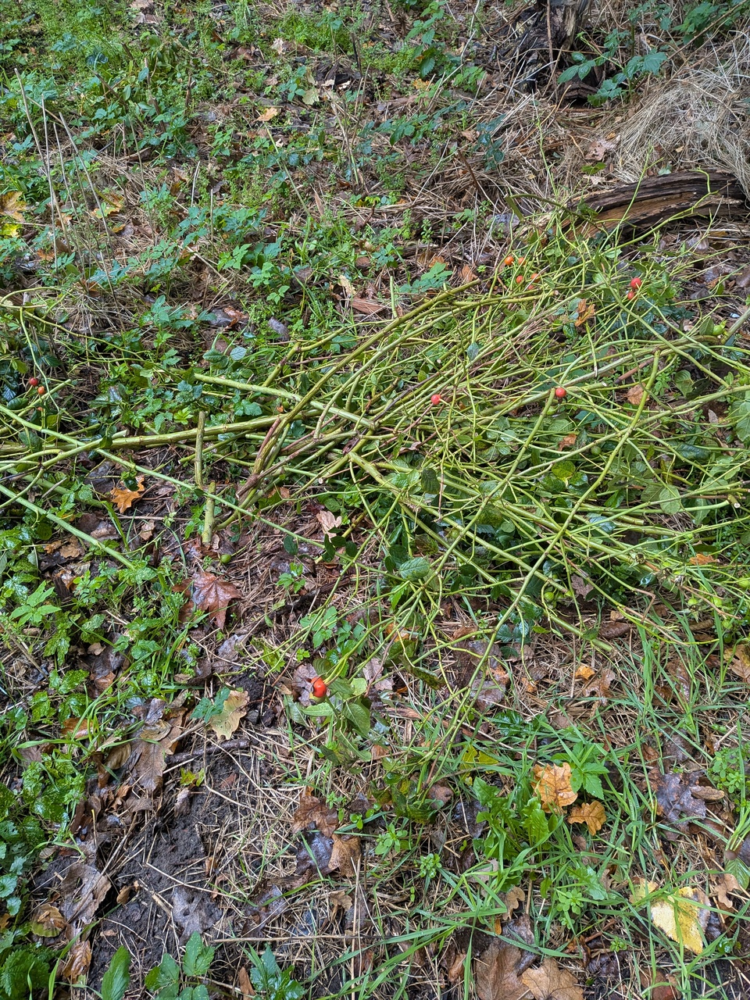
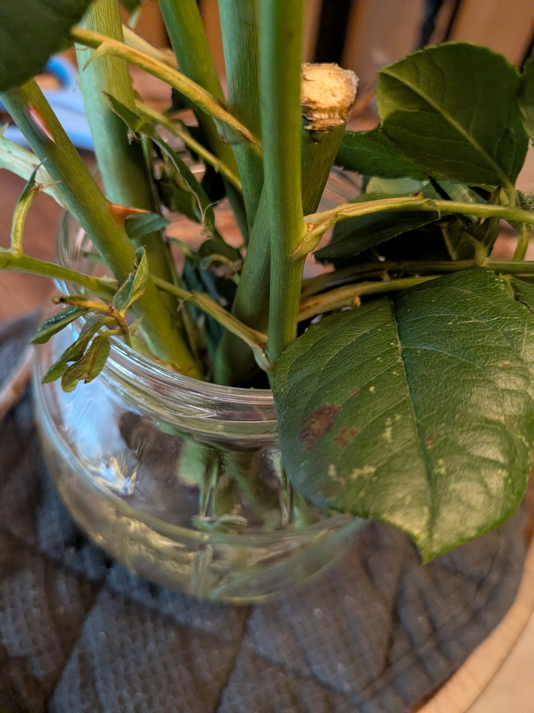
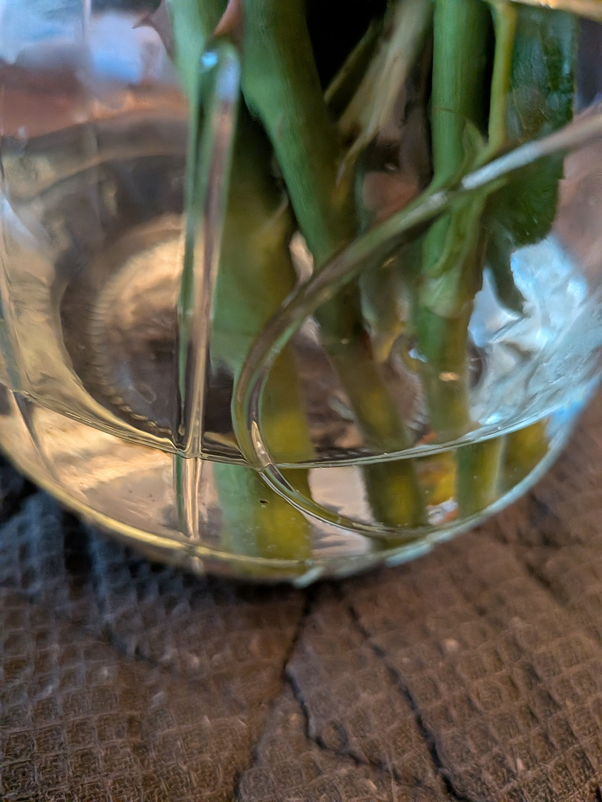
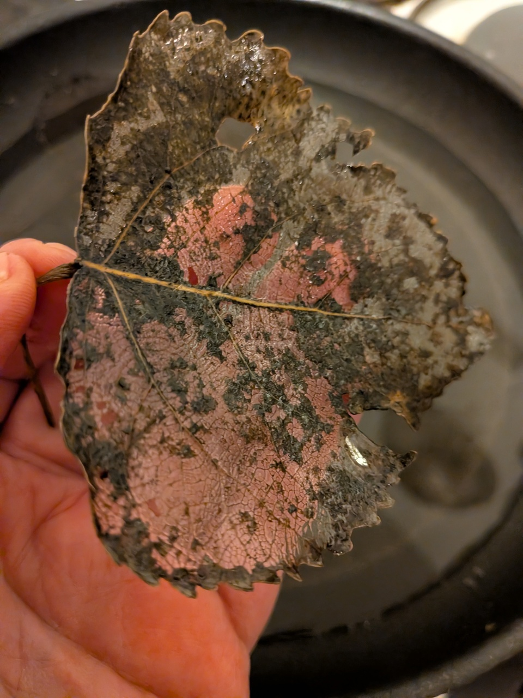
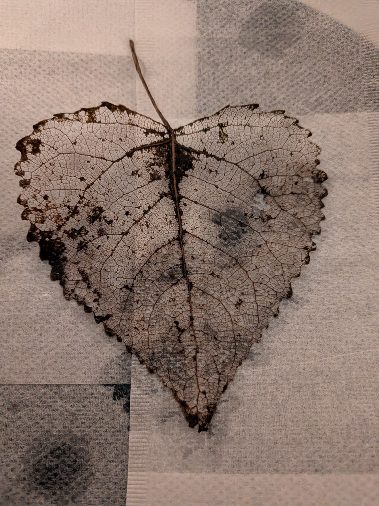

# Sammeln \#1

21\. Oktober 2026

Nachdem ich gestern [Plants For Free](../2026-10-20_schlaufuchs/) gelesen hatte, war ich angefixt. Ich musste heute unbedingt in den Wald.

Es ist Mittags. Ich packe meinen Rucksack mit einer Flasche Wasser , einer Schere und zwei Ziplock-Beuteln, in denen jeweils ein feuchtes Stück Küchenpapier liegt. Mein heutiges Ziel: Efeu *(Hedera helix)* sammeln. 

Zwar gibt es auch Efeu in unmittelbarer Nachbarschaft, aber ich finde es zum einen etwas seltsam, einfach bei Nachbarn etwas abzuknipsen (und ich habe keine Lust anzuklingeln und nachzufragen). Also habe ich ein Ziel: Efeu bei Bäumen in der Straße _Sieben Bösen_. Den habe ich reichlich entdeckt, als ich mal zum _Tweelbäker See_ gegangen bin. 

An einer Robinie *(Robinia pseudoacacia)* sehe ich diesen schönen Efeu. Ich möchte eigentlich genau den haben, aber der ist so fest mit dem Stamm verbunden, dass ich wohl beim Versuch, den Efeu zu lösen, versehentlich ein paar kleine Haftwurzeln abreiße. Ich lasse jeden weiteren Versuch sein und entdecke auf dem Boden noch weitere Stränge von dem Efeu. Von einem schneide ich ein ca. 15 cm langes Stück ab und wickle das abgeschnittene Ende direkt in feuchtes Küchenpapier, lege den Efeu in den Ziplock-Beutel, verschließe ihn und verstaue ihn im Rucksack.

*Efeu (Hedera helix) wächst an einer Robinie (Robinia pseudoacacia).*

Auf dem Boden liegend entdecke ich einen kleinen Ast, an dem ich nur noch das filigrane Skelett der Blätter sehe. Sie sehen super schön aus. Ich nehme diesen Ast mit, denn die Blätter möchte ich zuhause gerne pressen. Sie geben sicherlich einen schönen Schmuck ab.

*Das filigrane Blatt eines Baums. Es ist nur noch das Skelett übrig.*

In der Nähe des Efeus hat jemand Schnittgut hin geschmissen; es ist die Hundsrose *(Rosa canina)*, auch als *Hagebutte* bekannt. Hag ist übrigens Hecke, Butte ist Beere. Also *Heckenbeere*. 

*Nahaufnahme einer Hagebutte, der Beere der Hundsrose.*

Die abgeschnittenen Hundsrosen geben ein trauriges Bild ab. Ich schneide ein paar der Beeren ab als Deko für zuhause und Nehme einen großen Strang mit, um ihn zu Stecklingen zu machen. 

*Abgeschnittene Zweige der Hundsrose liegen aufeinander verstreut auf dem Waldboden*

Zuhause angekommen schneide ich den Zweig der Hundsrose in ca. 20 cm lange Stücke, genau unter einer Blattachse ab, damit sie dort anwurzelt. Eigentlich pflanzt man sie direkt in Erde, aber da wir uns schon auf unseren Umzug vorbereiten, möchte ich jetzt keine großen Experimente mehr machen. Entweder funktioniert es in Wasser, oder nicht. Es ist ein Experiment.

*Zweige der Hundsrose stehen als Stecklinge in einem Glas mit etwas Wasser.*

*Nahaufnahme der Zweige der Hundsrose, die in einem Glas Wasser stehen*

Die filigranen Blätter, bei denen fast nur noch das Skelett übrig ist, rollen sich auf dem Weg nach Hause leicht zusammen, da sie antrocknen. Zuhause lege ich sie in eine Pfanne mit Wasser, damit sie sich wieder vollsaugen können.

*In meiner Hand halte ich eines der gewässerten Blätter, von denen nur noch ein Skelett übrig ist. Im Hintergrund ist eine Pfanne mit Wasser.*

Eigentlich möchte ich die Blätter auf Kaffeefilter legen, habe aber anscheinend keine Kaffeefilter mehr und nehme Teefilter. Darüber kommt Küchenpapier. Ich erhoffe mir von den Teefiltern, dass die Blätter nicht kleben bleiben, wenn sie trocknen. Die Teefilter-Küchenpapier-Lagen kommen zwischen Zeitung. Backpapier kommt noch drumherum. Darauf stelle ich viele Bücher, damit die Blätter gut gepresst werden. Das Backpapier soll die Bücher schützen. Es ist ein Experiment.

*Ein Blatt, bei dem fast nur noch das Skelett zu sehen ist, liegt auf Papier*.

---  
[Startseite](/neuewurzeln/) // [Impressum](/impressum/) // [Datenschutz](/datenschutz/)
