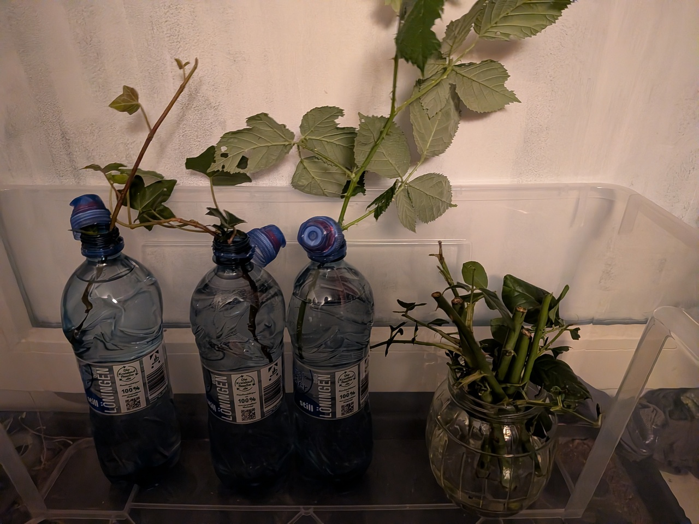
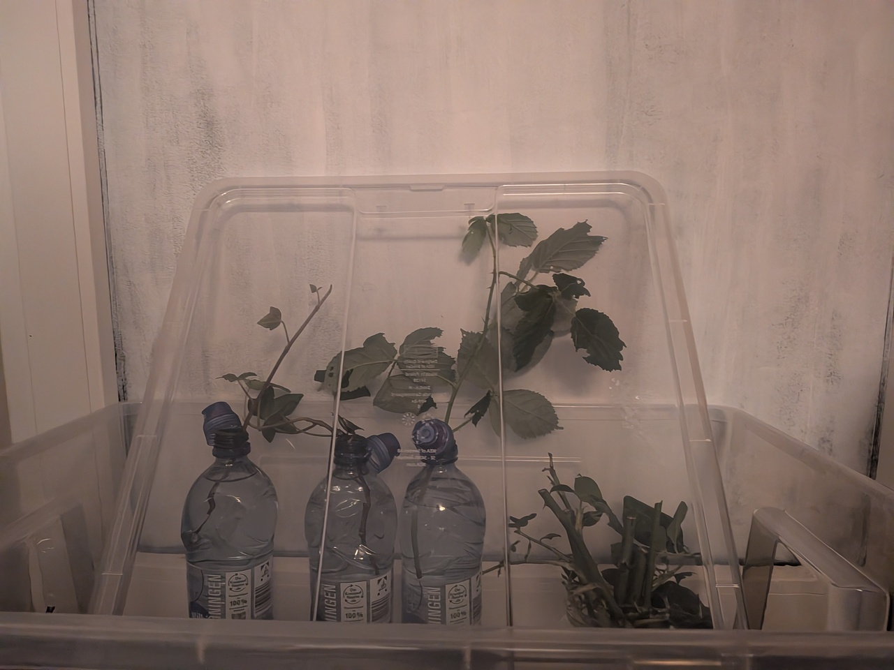

# Der Mensch war ein Jäger und Samla

22\. Oktober 2026

*Oder auch: der kleine Griff ins Klo.*

Ich habe gestern einen interessanten Artikel gelesen:  [Wo Blumenbilder wachsen: Mini Gewächshaus](https://www.wo-blumenbilder-wachsen.de/mini-gewaechshaus/). Im Beitrag wurde ein Mini-Gewächshaus aus durchsichtigen Plastikboxen vorgestellt, die man zum Beispiel bei IKEA bekommt und dort *Samla* heißen. 

Also ging es für uns heute zu IKEA, denn ich wollte auch so eine Box. Nun... im Laden kam sie mir größer vor. Wieder zuhause angekommen stellte ich fest, dass die Box doch ein "bisschen" kleiner ist, als erwartet. Aber hey: Für Anzuchtschalen sind sie bestimmt richtig gut. 

*Eine durchsichtige Plastikkiste. Drei Flaschen und ein Glas stehen in der Box. In den Flaschen stecken Zweige. Im Glas stecken ebenfalls kleine Zweige.*

*Eine Plastikbox. Ein Deckel ist über Pflanzen an ein Fenster gelehnt und überdacht so die Pflanzen in der Box.*

Gekauft habe ich [SAMLA Box, transparent, 56x39x28 cm/45 l](https://www.ikea.com/de/de/p/samla-box-transparent-30102974/) für 6,99 €, besser wäre wohl die [SAMLA Box, transparent, 56x39x42 cm/65 l](https://www.ikea.com/de/de/p/samla-box-transparent-00102975) für 9,99 € gewesen. Dazu kommt noch der Deckel, der 3,00 € kostet.

OK, war also nicht ganz das, was ich ursprünglich geplant hatte, aber hey: die nächste Box kommt bestimmt. Dann aber erst nach unserem Umzug.

---  
[Startseite](/neuewurzeln/) // [Impressum](/impressum/) // [Datenschutz](/datenschutz/)
