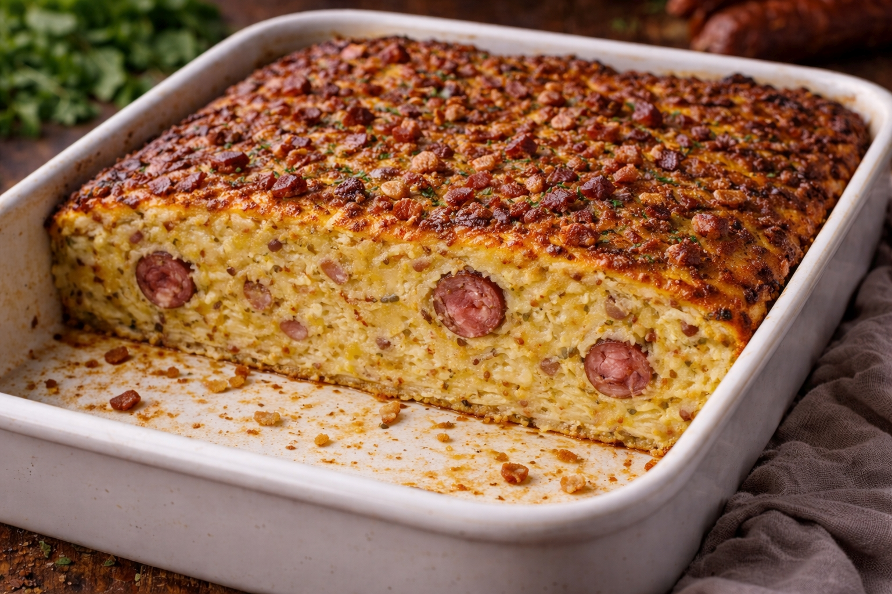

# Sauerländer Potthucke

### Zutaten
- 1,4 kg Kartoffeln  
- 3 Eier  
- 2 Zwiebeln  
- 150 g Mehl  
- 50 g geräucherter durchwachsener Speck  
- 4 Mettwürstchen/geräucherte Mettenden  
- 4 TL Salz  

### Zubereitung
1. Kartoffeln und Zwiebeln schälen und reiben. Eier und Mehl zugeben und vermengen.  
2. Kartoffelteig mit Salz, Pfeffer und Muskatnuss würzen. Kleingeschnittene Mettwurst hinzufügen und unterrühren.  
3. Ofenfeste Form mit Butter einfetten und den Teig einfüllen. Herausstehende Mettwurststücke unter die Masse drücken. Speckwürfel darüber streuen.  
4. Im vorgeheizten Backofen bei 200 °C Ober-/Unterhitze 90–110 Minuten backen, je nach Höhe der Masse.  
5. Direkt servieren oder nach kurzem Abkühlen in ca. 2 cm dicke Scheiben schneiden und in der Pfanne von beiden Seiten knusprig braten.  

### Notizen
- Dazu passt Kopfsalat mit Sauerrahmdressing.  
- Mettwurst kann auch am Stück in die Masse gelegt werden.

| 5/3 | 10/6 | 15/9 | Portionen bzw. Personen
| :--- | :--- | :--- | :--- |
| 2,5l | 5l | 7l | Größe der ofenfesten Form |
| 1,4kg | 2,8kg | 4,2kg | Kartoffeln |
| 3 | 6 | 9 | Eier |
| 2 | 4 | 6 | Zwiebeln |
| 150g | 300g | 450g | Mehl |
| 50g | 100g | 150g | geräucherter durchwachsener Speck |
| 4 | 8 | 12 | Mettwürstchen/geräucherte Mettenden |
| 4 | 8 | 12 | Tl. Salz |

---  
[Kategorie: Kartoffeln](../) // [Impressum](/impressum/) // [Datenschutz](/datenschutz/)