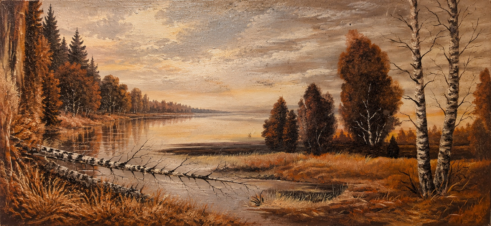

# Das Bild

25\. Oktober 2026

*Ölgemälde einer trostlosen Moorlandschaft mit Birken, abgestorbenem Gras, Bäumen in herbstlichem Laub und einem stehenden, morastigen Gewässer bei Sonnenuntergang. Das Bild ist mit KI erstellt und ich erkläre auch gleich, warum.*

Eines meiner Lieblingsbilder habe ich mal vor ein paar Jahren von einem Trödel-Opi geschenkt bekommen. Er hatte es in seiner Garage stehen. Wir waren dort, um Bilderrahmen abzuholen. Ich wollte das Bild für den Umzug schon mal einwickeln, da sah ich, dass es sehr seltsame Stockflecken überall hat: Das Bild beginnt zu schimmeln :( ... ich habe kein Geld für eine Restauration. Ich weiß auch nicht, ob es es was Wert ist. Ich weiß nur eins: Ich hab keinen Bock auf Schimmel. Also wandert das Bild in den Müll, so schwer es mir auch fällt.

Ich hätte gerne das Originalbild gezeigt. Aber das scheiß Urheberrecht in Deutschland, welches mir schon sehr häufig einen Strich durch die Rechnung gemacht hat, besagt, dass auch noch bis 70 Jahre nach dem Tod die Erben die Hand aufmachen können und Geld fordern. 70 ätzende Jahre ist ein Werk noch nach dem Tod des Künstlers oder der Künstlerin geschützt. Das leuchtet mir bei vielen Dingen absolut nicht ein. Ich gehe davon aus, dass sich die Erben oft nicht mehr für das Erbe interessieren und es in Vergessenheit gerät. In 70 Jahren sind locker 3 neue Generationen entstanden, wer besonders früh fleißig ist, schafft sogar 4 Generationen Nachwuchs. Es gibt so viele Kunst, die in Vergessenheit gerät. Leider auch dieses Bild (was ich erst 2036 zeigen darf.). Ich habe ChatGPT darum gebeten, eine Neuinterpretation des Bildes vorzunehmen. Und so entstand das (durchaus sehr hübsche) Bild. Es ist nicht das Original, aber vom Stil nah am Original. Die Landschaft ist bei diesem Bild hier anders arrangiert.

Ade du schönes Bild. Du kommst mit zum Entsorgungszentrum.

---  
[Startseite](/umzug/) // [Impressum](/impressum/) // [Datenschutz](/datenschutz/)
