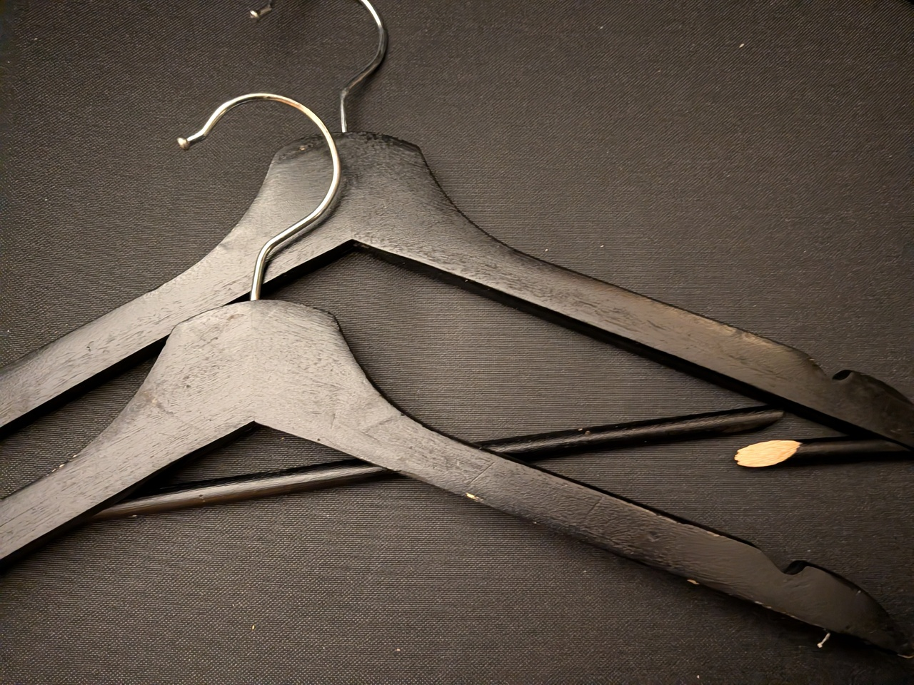
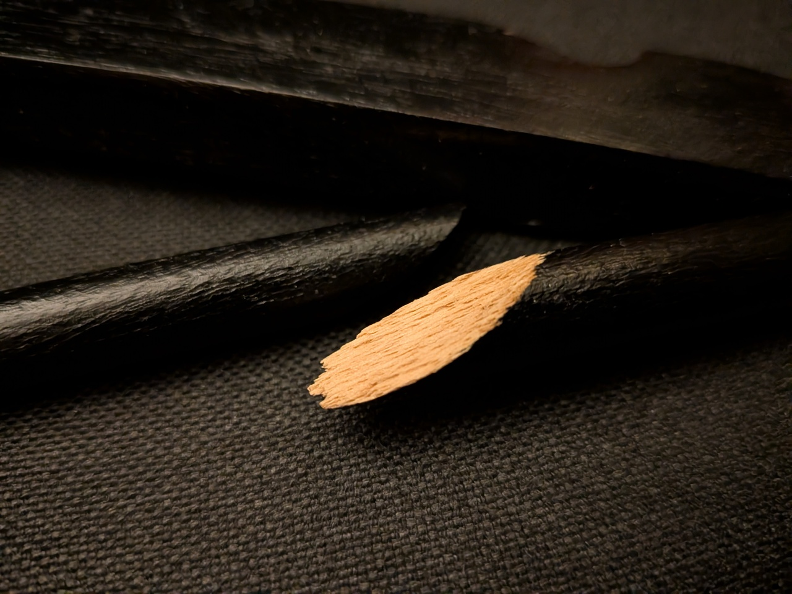
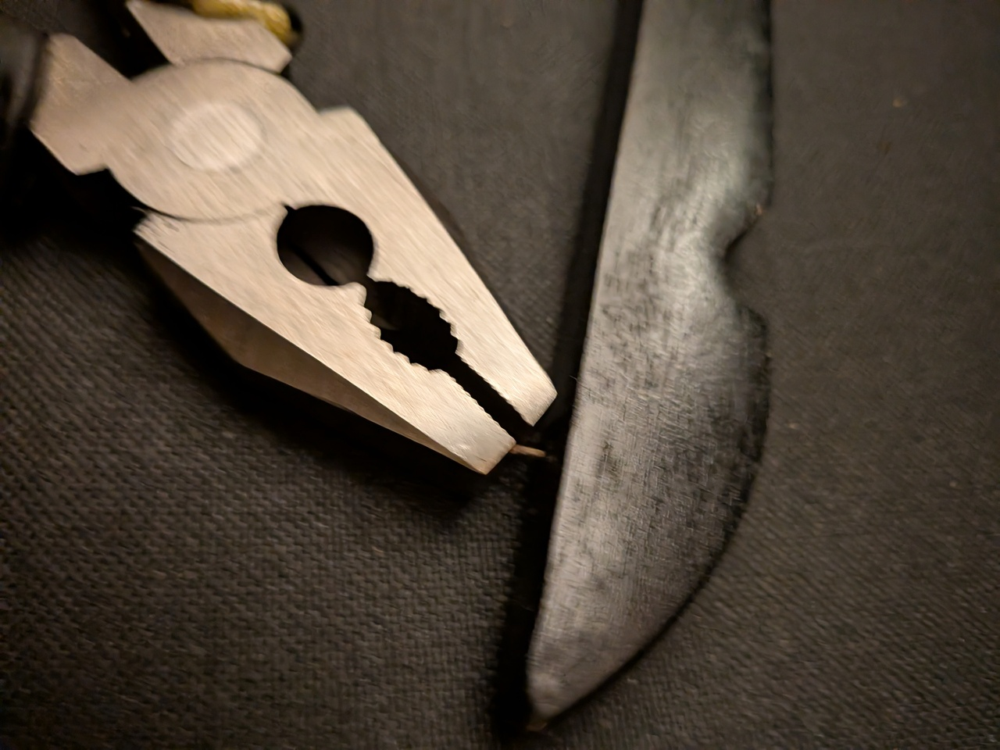

# Kleiderbügel aus Holz

24\. Oktober 2026

Etwas, was ich heute gerettet habe: Kleiderbügel. Durch ein Malheur sind die Mittelstreben bei drei Bügel gebrochen; eine Strebe habe ich mit Tesa geklebt ^^ ... die anderen beiden waren wirklich richtig kaputt. Ich habe die Streben entfernt und mit einer Zange die kleinen Nägel entfernt. Jetzt hab ich noch drei echt gute Bügel :) 

Ich freue mich darüber, die Bügel gerettet zu haben.

*Zwei schwarze Bügel. Bei einem Bügel ist die Mittelstrebe kaputt gebrochen.*

*Holz ist kaputt gebrochen. Man sieht die Holzfasern.*

*Mit einer Zange habe ich die kleinen Nägel heraus gezogen.*

---  
[Startseite](/urbanemine/) // [Impressum](/impressum/) // [Datenschutz](/datenschutz/)
